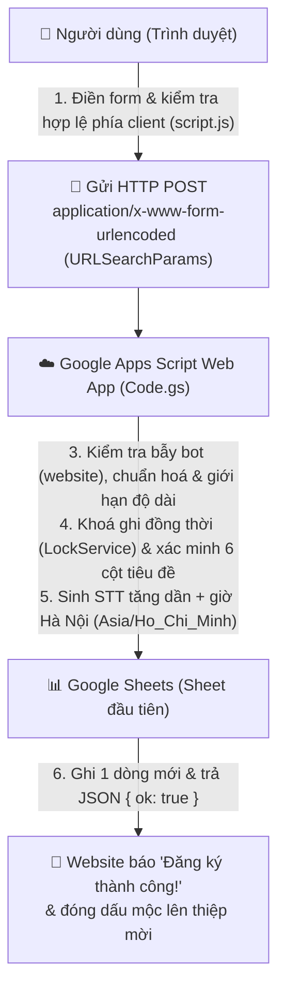

<div id="top" align="center">


<br />
<br />

# 🎄 CHRISTMAS WISHES – Điều Ước Mùa Giáng Sinh

**Website giới thiệu sự kiện và tiếp nhận đăng ký tham gia talkshow của CLB Thuyết trình**

🗓️ **20h00 tối · Ngày 25/12/2026** &nbsp;|&nbsp; 📍 **Trường Đại học Công Nghệ – ĐHQGHN, cơ sở Hoà Lạc**

<br />

<!-- Badges công nghệ & trạng thái -->
<p align="center">
  
  
  
  
  
</p>

<p align="center">
  
  
  
</p>

<!-- Thanh nút điều hướng nhanh -->
<p align="center">
  <a href="#muc-dich">🎯 Mục đích</a> •
  <a href="#bo-cuc">🎨 Bố cục & Giao diện</a> •
  <a href="#van-hanh">⚙️ Cách vận hành</a> •
  <a href="#bao-mat">🛡️ Bảo mật & An toàn dữ liệu</a>
</p>

<p align="center">
  <a href="./index.html">
    
  </a>
  <a href="./script.js">
    
  </a>
  <a href="./Code.gs">
    
  </a>
</p>

</div>

---

<a id="muc-dich"></a>

## 🎯 1. Mục đích

- 📣 **Quảng bá và truyền tải tinh thần sự kiện:** Giới thiệu chủ đề, thông điệp nhân văn của talkshow mùa Giáng sinh (sẻ chia điều ước, lắng nghe câu chuyện, lan tỏa sự đồng cảm), kèm thông tin thời gian, địa điểm và đồng hồ đếm ngược trực tiếp tới đêm tổ chức.
- 📝 **Thu thập đăng ký tham dự thuận tiện:** Cung cấp biểu mẫu đăng ký gọn nhẹ ngay trên cùng một trang để sinh viên đăng ký giữ chỗ, gửi trước câu hỏi cho khách mời/Ban Tổ Chức và lưu trực tiếp vào bảng Google Sheets quản lý danh sách.
- 🚀 **Tối ưu triển khai cho CLB sinh viên:** Xây dựng hoàn toàn bằng web tĩnh (HTML/CSS/JS thuần) kết hợp Google Apps Script, không cần thuê server hay cấu hình backend phức tạp.

---

<a id="bo-cuc"></a>

## 🎨 2. Bố cục và giao diện

### 🖌️ Chủ đề & bảng màu
Lấy cảm hứng từ **thiệp Giáng sinh thủ công**, sử dụng 4 tông màu chủ đạo cùng bộ font tiếng Việt sắc nét và hoạ tiết **SVG** (không lạm dụng icon máy):

| Vai trò | Tông màu | Mã màu tham chiếu |
| :--- | :--- | :--- |
| **Nền chính** (vân giấy nhung) | Đỏ đô |  |
| **Điểm nhấn lễ hội** | Xanh lá thông |  |
| **Nền giấy thư & đơn đăng ký** | Trắng kem |  |
| **Viền mạ vàng & nút nổi bật** | Vàng ánh kim |  |

- **Typography hỗ trợ trọn bộ dấu tiếng Việt:** `Playfair Display` (tiêu đề), `Be Vietnam Pro` (nội dung & form), `Dancing Script` (chữ viết tay tạo điểm nhấn).
- **Hoạ tiết SVG thủ công:** Cây thông Noel, xe trượt tuyết, đàn tuần lộc, nơ lụa, chuông vàng, lá nhựa ruồi, kẹo gậy, quả cầu tuyết, con dấu sáp.

### 📐 Cấu trúc trang (2 phần trọng tâm)

| Khu vực | Thành phần & Hiệu ứng nổi bật |
| :--- | :--- |
| **🧭 Thanh điều hướng (Navbar)** | Dính phía trên, căn giữa. Góc trái đặt logo CLB (`logo.png`) trong suốt trực tiếp trên nền navbar; chính giữa gồm 2 nút anchor link `Giới thiệu` và `Đăng ký tham gia` với thanh trượt nền vàng ánh kim và hiệu ứng cuộn mượt (`requestAnimationFrame`); trang trí lá nhựa ruồi tràn góc và dây đèn Giáng sinh nhấp nháy dọc mép dưới. |
| **✨ Phần Giới thiệu (`#gioi-thieu`)** | • **Hero mở đầu:** Tên talkshow, lời mời, khung Thời gian & Địa điểm, đồng hồ đếm ngược đến 20h00 ngày 25/12/2026, 2 nút kêu gọi hành động, 2 quả châu tương tác (bấm để mở lời chúc), rừng cây thông tuyết dưới chân Hero và hiệu ứng **Ông già Noel cùng tuần lộc lướt qua mỗi 5 giây** (giới hạn riêng trong phần giới thiệu).<br>• **Thư ngỏ & Thẻ quả cầu tuyết:** Trình bày câu chuyện chủ đề talkshow và những điểm nổi bật của đêm sự kiện.<br>• **Ý nghĩa chủ đề:** 3 thẻ nội dung cùng khung trích dẫn chuyển mạch tự nhiên xuống khu vực đăng ký. |
| **📮 Phần Đơn đăng ký (`#dang-ky`)** | • **Form bưu thiếp Giáng sinh:** 3 trường bắt buộc (`*Họ và tên`, `*Hiện tại đang học trường gì?`, `*Mã số sinh viên là gì?`), 1 trường tùy chọn (`Câu hỏi muốn gửi tới ban tổ chức (nếu có)` có bộ đếm 2000 ký tự) và nút **`Đăng ký`** được trang trí xe trượt tuyết Ông già Noel cùng 3 chú tuần lộc chạy dọc mép trên nút.<br>• **Thiệp mời xem trước trực tiếp (Live Ticket Preview):** Tự động cập nhật theo thông tin người dùng đang gõ và đóng dấu mộc **`ĐÃ ĐĂNG KÝ`** khi gửi đơn thành công. |
| **❄️ Hiệu ứng toàn trang & Responsive** | Tuyết rơi phủ nhẹ kèm nút `Tuyết rơi: Bật / Tắt` ở góc dưới phải, tự tôn trọng cài đặt giảm chuyển động (`prefers-reduced-motion`) và tương thích cả desktop lẫn điện thoại. |

---

<a id="van-hanh"></a>

## ⚙️ 3. Cách vận hành

### 🔄 Kiến trúc luồng dữ liệu



### 📂 Các tệp chính trong thư mục

| Tệp | Vai trò |
| :--- | :--- |
| [`index.html`](./index.html) | Cấu trúc trang web và thư viện biểu tượng SVG Giáng sinh |
| [`styles.css`](./styles.css) | Giao diện, responsive và toàn bộ animation CSS |
| [`script.js`](./script.js) | Xử lý cuộn mượt, đếm ngược, hiệu ứng tuyết/ông già Noel, xem trước thiệp, kiểm tra hợp lệ form và gọi API |
| [`Code.gs`](./Code.gs) | Mã nguồn backend chạy trên Google Apps Script để ghi dữ liệu vào Google Sheets |
| [`logo.png`](./logo.png), [`icon.png`](./icon.png) | Logo CLB Thuyết trình và favicon của website |

### ⚡ Chạy & triển khai nhanh

<details open>
<summary><strong>🌐 Chạy website tĩnh (Local hoặc GitHub Pages)</strong></summary>

- Mở trực tiếp tệp `index.html` trên trình duyệt, **hoặc** chạy server cục bộ:
  ```bash
  python -m http.server 8000
  ```
- Hoặc bật **GitHub Pages** trên nhánh `main` để xuất bản link công khai.

</details>

<details>
<summary><strong>☁️ Cập nhật backend Google Sheets (Apps Script)</strong></summary>

1. Dán nội dung [`Code.gs`](./Code.gs) vào Google Apps Script và bấm **Lưu (`Ctrl + S`)**.
2. Chọn **Deploy → Manage deployments → Edit → Version: `New version` → Deploy** để kích hoạt phiên bản mới mà không đổi URL `/exec`.

</details>

---

<a id="bao-mat"></a>

## 🛡️ 4. Độ bảo mật và an toàn của dữ liệu

### ✅ Các cơ chế bảo vệ đã áp dụng

| Lớp bảo vệ | Chi tiết triển khai |
| :--- | :--- |
| 🔒 **Truyền tải trực tiếp qua HTTPS** | Dữ liệu đăng ký gửi thẳng từ trình duyệt người dùng đến máy chủ Google Apps Script của Ban Tổ Chức, không đi qua bên trung gian thứ ba. |
| 📋 **Thu thập tối thiểu thông tin** | Chỉ lưu các trường phục vụ tổ chức sự kiện (`Họ và tên`, `Trường đang học`, `Mã số sinh viên`, `Câu hỏi`), không thu thập mật khẩu hay thông tin nhạy cảm. |
| 🧪 **Kiểm tra dữ liệu 2 lớp (Client + Server)** | Cả `script.js` và `Code.gs` đều kiểm tra trường bắt buộc, chuẩn hoá khoảng trắng và giới hạn độ dài tối đa (`120` / `200` / `40` / `2000` ký tự). |
| 🧹 **Chống XSS phía giao diện** | Mọi dữ liệu người dùng nhập khi hiển thị lên Thiệp mời xem trước hoặc thông báo kết quả đều gán bằng `textContent` và DOM API, không dùng `innerHTML`. |
| 🍯 **Chống bot spam cơ bản (Honeypot)** | Sử dụng trường ẩn `website`; bot tự điền trường này sẽ nhận phản hồi `{ "ok": true }` giả và bị bỏ qua, không ghi rác vào Google Sheets. |
| 🛑 **Chống tiêm công thức bảng tính (Formula Injection)** | `Code.gs` chặn các chuỗi bắt đầu bằng `=`, `+`, `-`, `@`, tab hoặc xuống dòng bằng ký tự thoát `'` và ép định dạng văn bản thuần `@` cho các cột dữ liệu. |
| ⏱️ **An toàn ghi đồng thời & chuẩn thời gian phía server** | Sử dụng `LockService.getScriptLock()` để tránh trùng `STT` khi nhiều người bấm đăng ký cùng lúc; cột `Thời gian đăng ký` được tạo từ phía server theo múi giờ cố định `Asia/Ho_Chi_Minh` (`GMT+7`) nên không bị phụ thuộc đồng hồ máy người dùng. |

### ⚠️ Giới hạn thực tế & khuyến nghị vận hành cho Ban Tổ Chức

> [!IMPORTANT]
> **Quyền truy cập Google Sheet:** Luôn giữ file Google Sheets ở chế độ **Hạn chế (Restricted)**, chỉ chia sẻ quyền xem/sửa cho thành viên Ban Tổ Chức (không bật chế độ *"Bất kỳ ai có đường liên kết đều xem được"*).

> [!NOTE]
> **Giới hạn chống spam quy mô lớn:** Do là form công khai không gắn CAPTCHA/đăng nhập, hệ thống chỉ chặn bot tự động cơ bản qua honeypot và chống bấm đúp phía trình duyệt; nếu cần chống spam nâng cao khi sự kiện mở quy mô rất lớn, nên bổ sung **Cloudflare Turnstile** hoặc **Google reCAPTCHA**.

> [!WARNING]
> **Thông tin cấu hình công khai:** Nếu repo GitHub đặt ở chế độ **Public**, `Code.gs` đang chứa `SPREADSHEET_ID` (người ngoài không có quyền chia sẻ vẫn không mở được file Sheet, nhưng có thể cân nhắc chuyển repo về **Private** hoặc lưu `SPREADSHEET_ID` trong `PropertiesService` của Apps Script).

---

<div align="center">

<sub>🎄 Thực hiện cho Talkshow <strong>CHRISTMAS WISHES – Điều Ước Mùa Giáng Sinh</strong> · CLB Thuyết trình</sub>
<br />
<sub><a href="#top">⬆️ Quay lại đầu trang</a></sub>

</div>
